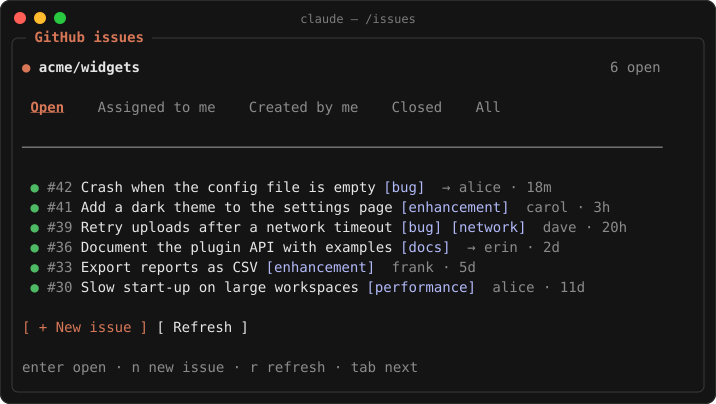

# GitHub Issues for Claude Code

Browse, create and close GitHub issues in a pane beside your Claude Code chat, and hand any
issue to Claude with one key: to discuss, plan, implement or reply to it.

<p align="center">
  
</p>

## Install

```
/plugin install gh-issues --marketplace Jajaho/claude-code-github-issues
```

You need the [GitHub CLI](https://cli.github.com/) installed and logged in (`gh auth login`),
and Claude Code started inside a clone of a GitHub repository.

## Use

| Command | Opens |
|---|---|
| `/issues` | the open issues of the current repository |
| `/issues 42` | issue #42 with its comments |
| `/issues new` | a form for a new issue |

- **Filter** by open, assigned to me, created by me, closed or all.
- **Read** an issue with its labels, assignees and comments, rendered as Markdown. Images
  show as `↗ image` links that open in the browser.
- **See and edit the issue's details**, as in GitHub's sidebar: type, fields, projects,
  milestone, relationships (parent, sub-issues, blocked by, blocking) and development
  (linked branches and pull requests). `e` opens the editor, where chips toggle a value and
  related issues are added by number or URL; a related issue opens with a click.
- **Set them on a new issue** too: type, fields, projects, milestone, parent and blockers,
  and a linked branch made once it exists. A milestone can be created from the form.
- **Comment, close or reopen** without leaving the terminal.
- **Hand the issue to Claude** from the issue's Claude dropdown: picking an action runs it,
  and Claude reads the issue and its thread first.
  - **Discuss**: what the issue asks, open questions and two or three ways to go, then
    Claude asks you which. No edits, branches or GitHub writes.
  - **Plan**: a step-by-step plan of files, tests and risks, for you to approve.
  - **Implement**: branch, implement, test and commit. It never pushes, opens a pull request
    or touches the issue unless you ask.
  - **Reply**: Claude writes a comment and posts it.
  - **Reply (Draft)**: Claude writes a comment into the pane's comment box, where you edit it
    and post it yourself.
  - **Ask…**: puts a line naming the issue in the prompt box; press `Esc` and type your own
    question.

Keys in the pane: `n` new issue, `r` refresh, `b` back, `e` edit details, `c` close, `Tab` to
move (to the Claude dropdown too, where the arrows choose and `Enter` runs), `Esc` back to the
prompt.

Issue types and fields exist only in repositories owned by an organization; elsewhere the
pane leaves them out. Projects need
the `project` scope on your gh token: `gh auth refresh -s project`. Without it the pane
still shows everything else.

You can also just ask in the chat, for example *"show me the open bugs"* or *"file an issue
about the slow start-up"*.

## License

MIT
